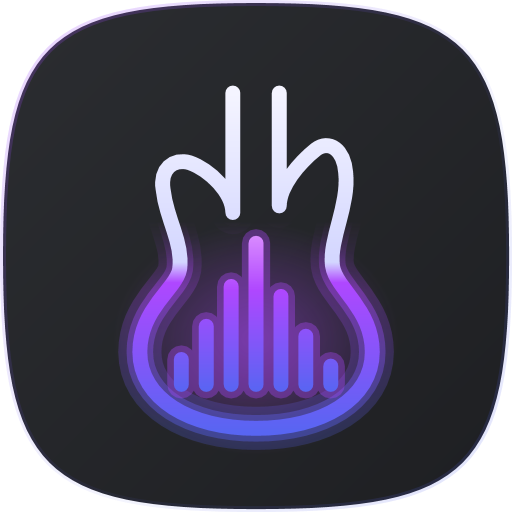
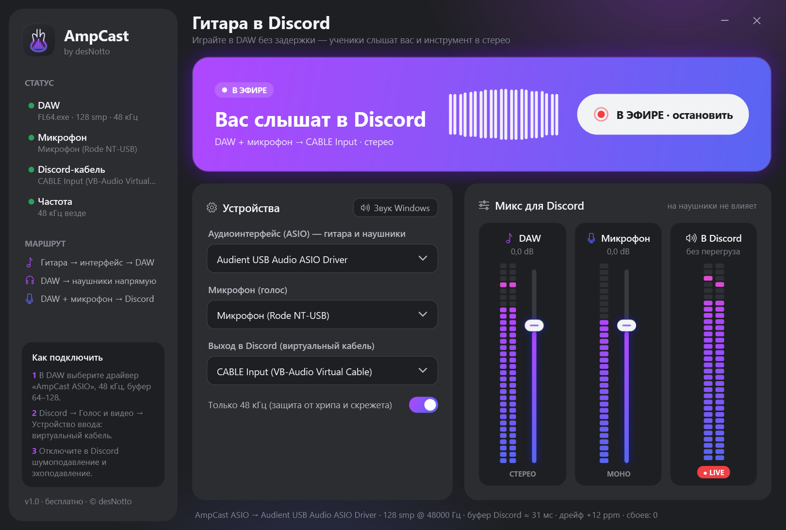

<p align="center"></p>

# AmpCast

**by desNotto** · бесплатная программа для Windows 10/11.

Преподаватель или музыкант играет на электрогитаре через DAW (FL Studio, Ableton,
Studio One, Reaper, Cubase…), слышит себя в наушниках **без добавленной задержки**,
а в Discord параллельно уходит **стерео-микс DAW + голос с микрофона**.



## Скачать

**[AmpCast-Setup-1.0.3.exe](https://github.com/desNotto/AmpCast/releases/latest)** — установщик
(Windows 10/11, 64-бит; .NET ставить не нужно). Для Discord дополнительно нужен
бесплатный виртуальный кабель [VB-CABLE](https://vb-audio.com/Cable/) — после установки
AmpCast покажет пошаговую инструкцию.

---

## Архитектура

```
 Гитара ─► аудиоинтерфейс ─ASIO─► ┌──────────────────────────────┐
                                  │  AmpCast ASIO  (C++ DLL)     │  ◄── выбирает DAW
 Наушники ◄─ аудиоинтерфейс ◄──── │  работает ВНУТРИ процесса DAW │
                                  │  отдаёт DAW буферы «железа»  │
                                  └──────────────┬───────────────┘
                                                 │ копия мастера DAW (общая память, lock-free)
                                                 ▼
 Микрофон ─WASAPI─► ┌────────────────────────────────────────────┐
                    │  AmpCast.exe (C#/.NET 10, WPF, NAudio)      │
                    │  ресэмплинг + компенсация дрейфа часов,     │
                    │  громкости, Mute, мягкий лимитер, VU-метры  │
                    └──────────────┬─────────────────────────────┘
                                   ▼ WASAPI
                       виртуальный кабель ─► Discord (устройство ввода)
```

### Почему не «как в исходном ТЗ» (и почему так лучше)

| Идея из ТЗ | Проблема | Как решено |
|---|---|---|
| Виртуальный ASIO-драйвер «через NAudio» | NAudio — это **ASIO-хост**, он не умеет *быть* драйвером. ASIO-драйвер — это нативная COM-DLL, которую DAW загружает в свой процесс. Записи в реестре без такой DLL дадут пункт в меню DAW, который не откроется. | Драйвер написан на C++ (`src/AmpCast.Asio`), реестр заполняет C# (`AsioRegistration.cs`). |
| C#-приложение открывает реальную карту через `AsioOut`, а DAW — виртуальный ASIO | Почти все ASIO-драйверы **эксклюзивны**: карту может открыть только одна программа. Плюс два ASIO-клиента = два буфера = двойная задержка. | Карту открывает сам драйвер AmpCast внутри DAW и отдаёт DAW её **собственные буферы** (zero-copy). Задержка = задержке вашей карты, ровно как без AmpCast. |
| GC в C# даёт щелчки на буфере 64/128 | Верно. | Путь «гитара → наушники» вообще не проходит через .NET. В C# остался только путь в Discord (буфер ~30 мс, ему 1 мс паузы GC не страшна), и он всё равно написан без аллокаций в колбэках. |
| 44.1 vs 48 кГц = хрип | Верно, плюс у любых двух устройств немного разные кварцы (дрейф). | Драйвер по умолчанию **разрешает DAW только 48 кГц** (переключатель в UI). Если Windows-устройства на 44.1 — AmpCast пересчитывает и предупреждает. Дрейф часов компенсируется адаптивным ресэмплингом (±0.1 %, неслышно) — без щелчков раз в N минут. |

## Что где лежит

```
src/AmpCast.Asio/            C++: виртуальный ASIO-драйвер «AmpCast ASIO»
  src/asio_abi.h             ABI интерфейса IASIO (структуры, vtable, константы)
  src/AmpCastAsio.cpp        обёртка над реальной картой + отвод мастера в общую память
  src/SharedBus.*            lock-free кольцевой буфер в shared memory
  src/dllmain.cpp            COM-фабрика, regsvr32-регистрация
src/AmpCast/                 C# WPF-приложение
  Audio/AudioEngine.cs       ядро: WASAPI-микрофон + микс + вывод в кабель
  Audio/AdaptiveStreamReader.cs  ресэмплинг + компенсация дрейфа
  Audio/SharedDawBus.cs      чтение общей памяти драйвера
  Setup/AsioRegistration.cs  ключи HKLM\SOFTWARE\ASIO (шаг 2 ТЗ)
  Setup/DriverInstaller.cs   тихая установка виртуального кабеля (шаг 3 ТЗ)
  MainWindow.xaml            интерфейс (шаг 4 ТЗ)
  Themes/                    палитра «Deep Discord», логотип (вектор)
installer/AmpCast.iss        Inno Setup
driver/                      сюда кладётся подписанный пакет виртуального кабеля
tools/make-icon.ps1          векторный логотип → AmpCast.ico + PNG
```

## Сборка

Нужно: **Build Tools for Visual Studio 2022** (компонент «Разработка классических
приложений на C++»), **.NET SDK 10**, **Inno Setup 6** (`winget install JRSoftware.InnoSetup`).

```powershell
.\build.ps1
```

Результат: `build\publish\` (программа) и `build\installer\AmpCast-Setup-1.0.3.exe`.

Только C#-часть (без драйвера): `dotnet build src\AmpCast\AmpCast.csproj`.
Превью интерфейса без звука: `AmpCast.exe --render-preview preview.png`.

## Установка (что делает инсталлятор)

1. Копирует программу и `AmpCastAsio64.dll` / `AmpCastAsio32.dll` (для 64- и 32-битных DAW).
2. `AmpCast.exe --register-asio` — прописывает драйвер в `HKLM\SOFTWARE\ASIO` и COM
   (`HKLM\SOFTWARE\Classes\CLSID`) в обоих видах реестра.
3. Если в `driver\` лежит пакет кабеля — `AmpCast.exe --install-driver <inf> <hwid>`:
   создаёт корневое устройство и ставит драйвер (аналог `devcon install`; одного
   `pnputil /add-driver` для виртуальной карты недостаточно — устройство не появится).
4. При удалении — всё в обратном порядке.

## Настройка у пользователя

1. AmpCast → выберите **свой аудиоинтерфейс**, **микрофон** и **виртуальный кабель**.
2. DAW → аудио-драйвер **AmpCast ASIO**, 48 кГц, буфер 64–128 (буфер меняется
   кнопкой «ASIO Panel» в DAW — откроется панель вашей карты).
   Мастер DAW (выходы 1/2) автоматически уходит и в наушники, и в Discord.
   Дополнительные выходы **«AmpCast Discord L/R»** — то, что должно звучать
   *только* в Discord (например, метроном для учеников).
3. Discord → Голос и видео → Устройство ввода: виртуальный кабель;
   выключить шумоподавление, эхоподавление и автоматическую регулировку усиления.
4. Нажать **«Транслировать в Discord»**. Окно можно закрыть — AmpCast работает в трее.

### Стерео

Голосовой канал Discord сводит любой микрофон (и виртуальный кабель) в **моно** —
это ограничение Discord. Звук **демонстрации экрана** приложения остаётся стерео, поэтому:

1. AmpCast → включить **«Стерео через демонстрацию экрана»**.
2. Discord → Устройство ввода: **ваш микрофон**, не кабель — голос идёт обычным путём.
3. Discord → **Демонстрация экрана → окно вашей DAW**, звук включён.

Как это работает: DAW играет через ASIO, а такой звук Discord захватить не может.
В стерео-режиме драйвер AmpCast ASIO (он и так работает внутри DAW) дополнительно
проигрывает микс DAW обычным звуком Windows в виртуальный кабель, который никто не
слушает. Discord захватывает звук процесса показанного окна — то есть DAW — в стерео.
Звуковой поток DAW это не затрагивает: вывод идёт отдельным потоком из общей памяти.

Если звука в трансляции нет — в Discord → Голос и видео выключите/включите
«экспериментальный способ захвата звука из приложений».

## Ограничения и что осталось сделать

- **Версия 1.0 — тестовая.** Драйвер проверен тестовым ASIO-хостом
  (`tools/asio-smoke`) на Audient USB Audio (x64 и x86, 48 кГц); проверка в
  FL Studio / Reaper / Ableton / Studio One ещё идёт — сообщайте о проблемах в Issues.
- **Виртуальный кабель**: драйвер режима ядра требует подписи Microsoft. Варианты —
  в [driver/README.md](driver/README.md). Без него AmpCast работает с уже
  установленным VB-CABLE или любым другим виртуальным устройством.
- **ASIO** — товарный знак Steinberg. Проект не включает исходники ASIO SDK, но
  перед публичным релизом драйвера ознакомьтесь с лицензионными условиями Steinberg.
- Мониторинг с другой частотой, чем 48 кГц, работает при выключенном замке 48 кГц,
  но не рекомендуется.
